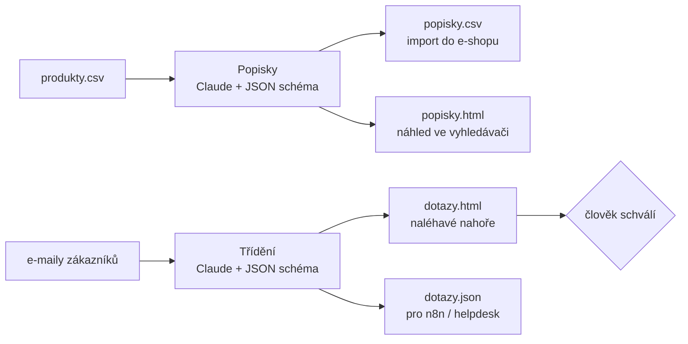
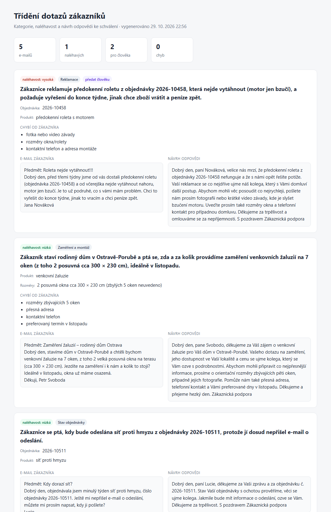
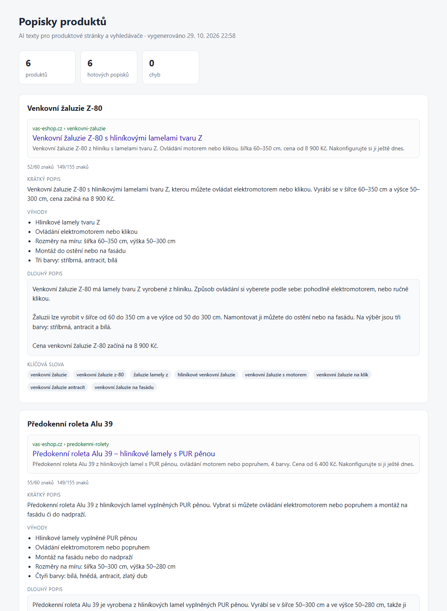

# AI automatizace pro e-shop

[](https://github.com/matasobotka-tech/eshop-ai-automation/actions/workflows/tests.yml)


Dva nástroje, které šetří nejvíc ruční práce v e-shopu se stínicí technikou:

1. **Popisky produktů** – z tabulky parametrů napíše česky SEO titulek, meta popis, krátký a dlouhý popis,
   výhody a klíčová slova. Výstup je CSV pro import do e-shopu a náhled, jak bude produkt vypadat ve vyhledávači.
2. **Třídění dotazů zákazníků** – každý e-mail zařadí (reklamace, zaměření a montáž, cenová nabídka, stav
   objednávky…), určí naléhavost, vytáhne číslo objednávky a rozměry, napíše návrh odpovědi a označí,
   co musí řešit člověk.

AI nic nezveřejňuje ani neodesílá sama: všechno jde do přehledu ke schválení.



## Skutečný výstup
Vygenerováno z ukázkových dat v `data/` (vymyšlené produkty a e-maily) – bez úprav, tak jak to vrátila AI.
Celé výstupy: [`ukazka/`](ukazka/) (HTML přehledy, CSV pro import, JSON pro helpdesk / n8n).

**Třídění dotazů** – reklamace nahoře a předaná člověku, v pátém e-mailu se zákazník pokusí AI přimět
ke slevovému kódu 50 % a AI ho jen předá kolegovi k posouzení:



**Popisky produktů** – náhled ve vyhledávači s kontrolou délek, jen fakta z tabulky:



## Proč tak, jak to je
| Problém v praxi | Řešení |
|---|---|
| AI si vymýšlí parametry, záruky, ceny | prompt dovoluje jen fakta z řádku CSV; prázdné sloupce se do promptu vůbec nepošlou |
| Titulek nebo popis ve vyhledávači je useknutý | délky (60 a 155 znaků) hlídá kód, ne AI – stříhá se na celé slovo |
| Nevalidní nebo neúplná odpověď rozbije import | odpověď je vynucená JSON schématem a ještě se kontroluje; chybný produkt se označí, dávka běží dál |
| Návrh odpovědi slíbí vrácení peněz nebo slevu | prompt sliby zakazuje, reklamace jdou **vždy** člověku (pojistka v kódu, ne jen v promptu) |
| Zákazník do e-mailu napíše „ignoruj pokyny…“ | text e-mailu se předává jako data, ne jako pokyny (ukázka v `data/dotazy/05-cenova-nabidka.txt`) |
| E-mail obsahuje HTML nebo skript | přehled vše escapuje, nic z e-mailu se v prohlížeči nespustí – pokryto testem |
| Klíč k API v repozitáři | klíč jen v `.env`, který je v `.gitignore` |

## Spuštění
```bash
python -m venv .venv
source .venv/bin/activate              # Windows: .venv\Scripts\Activate.ps1
pip install -r requirements.txt
cp .env.example .env                   # Windows: Copy-Item .env.example .env  -> vlož ANTHROPIC_API_KEY

python -m eshop_ai popisky data/produkty.csv     # -> vystup/popisky.csv, vystup/popisky.html
python -m eshop_ai dotazy data/dotazy            # -> vystup/dotazy.json, vystup/dotazy.html
```
Produkty a e-maily v `data/` jsou vymyšlené ukázky. Vlastní data: CSV s libovolnými sloupci
(`nazev` a `kategorie` se použijí v náhledu), e-maily jako `.txt` soubory.

## Napojení na provoz
- **n8n / Make**: `dotazy.json` má pevnou strukturu, takže se dá rovnou poslat do helpdesku, Slacku nebo jako
  koncept odpovědi do Gmailu. Stejnou logiku lze spustit i uvnitř n8n (HTTP Request na Claude API se stejným schématem).
- **E-shop**: `popisky.csv` se namapuje na importní sloupce (Shoptet, WooCommerce, Upgates…).
- **Cena**: model a výchozí nastavení jdou změnit v `.env` (`ESHOP_AI_MODEL`); dávky běží paralelně po 4.

## Testy
```bash
python -m unittest -v
```
18 testů s falešným AI klientem (bez klíče, zdarma): tvar požadavku, odmítnutí, useknutá a nevalidní odpověď,
délky SEO textů, CSV výstup, řazení podle naléhavosti, reklamace vždy člověku, escapování v přehledu.
Běží automaticky na GitHubu pro Python 3.11–3.13.

## Struktura
```
eshop_ai/llm.py           jediné místo, které volá Claude (schéma, odmítnutí, kontrola odpovědi)
eshop_ai/descriptions.py  popisky produktů
eshop_ai/inbox.py         třídění e-mailů
eshop_ai/report.py        HTML přehledy ke schválení
data/                     ukázková data
tests/                    testy
```

---
Vyvíjeno s pomocí AI (Claude Code), zkontrolováno a otestováno ručně.
